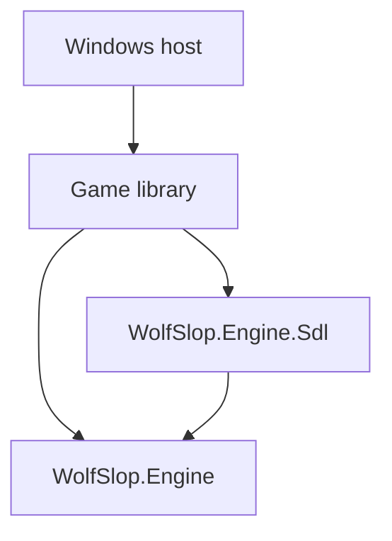

# Native platform architecture

The portable engine targets `net10.0`. The Windows provider uses SDL3 and SDL GPU; the application owns initialization, Windows runtime packages, content directories, window lifetime, and game composition.

Core must not reference a provider, platform SDK, or native binding. Scene updates and UI mutation stay on the window thread. File loading can run asynchronously, but GPU creation/upload/submission must return to the SDL thread. The host uses synchronous composition around asynchronous JSON loading to preserve this rule.

`ISceneRenderer` consumes `RenderMap`/`RenderFrame`. SDL GPU runs a compute ray pass, surface pass and sorted sprite pass, retains world columns for interlacing, and composites UI at presentation. The host queues a frame with `Render`, draws UI, then calls `Present`. Shader resources obey SDL register-space conventions. HLSL is compiled offline into SPIR-V and DXIL by `Tools/ShaderCompiler`; the game has no compiler dependency.

`SdlUiRenderer` rasterizes portable UI through SkiaSharp, including font measurement, images, affine transforms, clipping, and vector drawings. SDL GPU uploads the premultiplied result for composition. Native OS accessibility and general text editing/IME are not implemented by this provider; the racing menus use buttons rather than text editors.

`SdlInput` translates physical keys, relative mouse motion, and focus loss into portable input. The application pauses on focus loss and clears held controls. The game caps resumed simulation steps; SDL handles surface resizing through swapchain acquisition. GPU device-loss recovery is not implemented: failures terminate with an explicit error.

`SdlAudioBackend` streams music with SDL_mixer. `SdlSfxBackend<TCue>` decodes clips, maintains voices, supports loop phase, pause, gain, pan, and pitch; game policy retains queue crossfades and spatial mixing. Hosts supply a file-backed content directory because streaming decoders require stable files.

Runtime native libraries belong to the Windows executable. The application uses Windows SDL and mixer packages, with `win-x64` as the default runtime identifier. Both D3D12 and Vulkan backends are exercised by the Windows smoke tests.

The engine core stays independent of the host and native libraries. Windows is the only application/build target currently supported.
