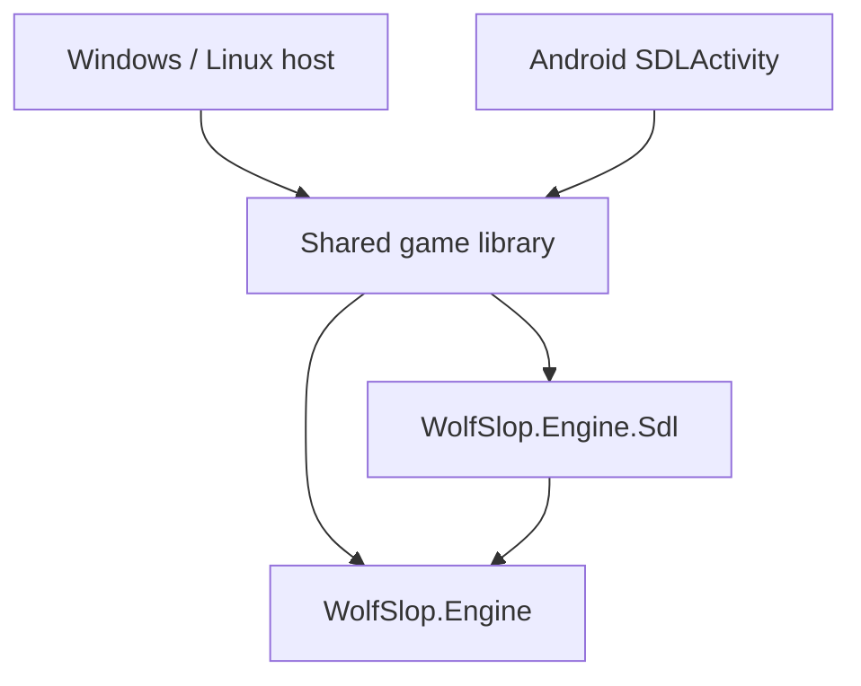

# Native platform architecture

The portable engine targets `net10.0`. The native provider uses SDL3 and SDL GPU; platform hosts own initialization, native runtime packages, content directories, window/activity lifetime, and application composition.

Core must not reference a provider, platform SDK, or native binding. Scene updates and UI mutation stay on the window thread. File loading can run asynchronously, but GPU creation/upload/submission must return to the SDL thread. The host uses synchronous composition around asynchronous JSON loading to preserve this rule.

`ISceneRenderer` consumes `RenderMap`/`RenderFrame`. SDL GPU runs a compute ray pass, surface pass and sorted sprite pass, retains world columns for interlacing, and composites UI at presentation. The host queues a frame with `Render`, draws UI, then calls `Present`. Shader resources obey SDL register-space conventions. HLSL is compiled offline into SPIR-V and DXIL by `Tools/ShaderCompiler`; the game has no compiler dependency.

`SdlUiRenderer` rasterizes portable UI through SkiaSharp, including font measurement, images, affine transforms, clipping, and vector drawings. SDL GPU uploads the premultiplied result for composition. This CPU rasterization/upload path needs profiling on mobile. Native OS accessibility and general text editing/IME are not implemented by this provider; the racing menus use buttons rather than text editors.

`SdlInput` translates physical keys, relative mouse motion, focus loss, and multitouch into portable input. Android avoids mouse capture and uses touch regions. Hosts pause on focus/background loss and clear held controls. The game caps resumed simulation steps; SDL handles surface resizing through swapchain acquisition. GPU device-loss recovery is not implemented: failures terminate with an explicit error.

`SdlAudioBackend` streams music with SDL_mixer. `SdlSfxBackend<TCue>` decodes clips, maintains voices, supports loop phase, pause, gain, pan, and pitch; game policy retains queue crossfades and spatial mixing. Hosts supply a file-backed content directory because streaming decoders require stable files. Android extracts APK assets into private storage.

Runtime native libraries belong to executable hosts, avoiding accidental desktop-library inclusion in Android APKs. Desktop packages include Windows/Linux SDL and mixer libraries; Android supplies its SDLActivity bridge and Android native packages. Vulkan device creation disables unused optional features. Android also disables optional anisotropy and reports 1× filtering.

The Windows renderer is exercised with D3D12 and Vulkan. Cross-publishing Linux and building an Android APK do not establish device/runtime compatibility. Real Android GPU, touch, audio, DPI, and background/resume tests remain necessary, as does a Linux runtime test.
